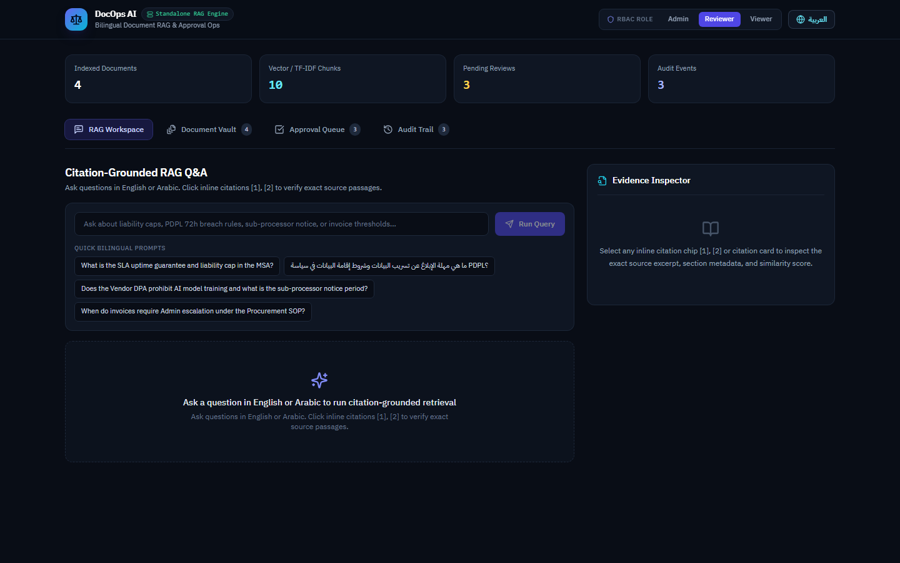
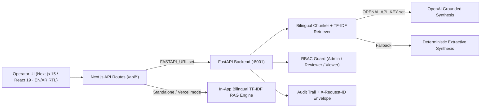

# DocOps AI

**Live Demo:** https://docops-ai-demo.vercel.app

**Bilingual (EN / AR RTL) Document RAG & Human-in-the-Loop Approval Ops Platform**

DocOps AI is an enterprise document intelligence and compliance operations workspace built for legal, procurement, and Gulf/MENA bilingual workflows. It combines citation-grounded Retrieval-Augmented Generation (RAG) across English and Arabic documents with RBAC-gated clause approval queues and an immutable request-traced audit trail.



---

## Architecture



---

## Key Features

- **Full Bilingual EN / AR + RTL Support**: Instant language toggle switches both UI copy and `dir="rtl"` / `dir="ltr"` layout using logical CSS utilities, with Arabic normalization (diacritics, Alef/Taa Marbuta/Yaa) and cross-lingual legal/compliance synonym expansion.
- **Document Vault & Live Ingestion**: Browse indexed English, Arabic, and Bilingual contracts/policies by status (`Indexed`, `Processing`, `Flagged`), chunk count, and language. Upload `.txt`/`.md` files or paste raw text to chunk, index, and auto-scan for risk clauses in real time.
- **RAG Q&A with Clickable Citations & Evidence Inspector**: Streaming-style grounded answers with inline citation chips (`[1]`, `[2]`). Clicking any citation highlights the exact source passage, document title, section/page reference, and similarity score in the right-hand **Evidence Inspector** drawer.
- **Human-in-the-Loop Approval Queue with Live RBAC**: AI-extracted risk flags with `Approve`, `Request Revision`, and `Escalate` actions gated by `X-User-Role` (`Admin`, `Reviewer`, `Viewer`). Switching to `Viewer` locks mutation controls in both the UI and backend API (`403 Forbidden`).
- **Immutable Audit Trail**: Every RAG query, document ingestion, RBAC role switch, approval decision, and denied attempt is logged chronologically with `request_id` and UTC `timestamp`.
- **Zero-Dependency Vercel Deployability**: Next.js API routes transparently proxy to FastAPI when `FASTAPI_URL` is configured, or execute the built-in TypeScript TF-IDF RAG + state engine when deployed standalone.

---

## Quick Start

### Option 1: Docker Compose (Frontend `:3001` + FastAPI `:8001`)

```bash
cp .env.example .env
docker compose up --build
```

- Frontend: `http://localhost:3001`
- Backend API & Swagger Docs: `http://localhost:8001/docs`

### Option 2: Local Development

**Backend (Python 3.12+):**

```bash
cd backend
pip install -r requirements.txt
uvicorn main:app --host 0.0.0.0 --port 8001 --reload
```

Run backend tests:

```bash
cd backend
pytest -v
```

**Frontend (Node 20+):**

```bash
cd frontend
npm install
npm run dev
```

Open `http://localhost:3001`. Leave `FASTAPI_URL` unset for standalone mode, or set `FASTAPI_URL=http://localhost:8001` in `frontend/.env.local` to connect to FastAPI.

---

## REST API Reference (FastAPI `:8001`)

All endpoints return a unified response envelope `{ "request_id", "timestamp", "data" }` and echo `X-Request-ID` in response headers.

| Method | Endpoint | RBAC Header (`X-User-Role`) | Description |
|---|---|---|---|
| `GET` | `/health` | Any | Service status, indexed document & chunk counts |
| `GET` | `/api/v1/documents` | Any | List indexed documents and metadata |
| `POST` | `/api/v1/documents` | `Admin`, `Reviewer` | Chunk, index, and risk-scan a new document |
| `POST` | `/api/v1/rag/query` | Any | Bilingual TF-IDF retrieval + OpenAI/extractive answer with citations |
| `GET` | `/api/v1/approvals` | Any | List AI-extracted risk flags in the approval queue |
| `POST` | `/api/v1/approvals/{id}/decision` | `Admin`, `Reviewer` | Submit `approve`, `request_revision`, or `escalate` decision |
| `GET` | `/api/v1/audit-logs` | Any | Retrieve chronological operational audit log |
| `POST` | `/api/v1/audit-logs` | Any | Record an operator audit event (e.g. RBAC role switch) |
